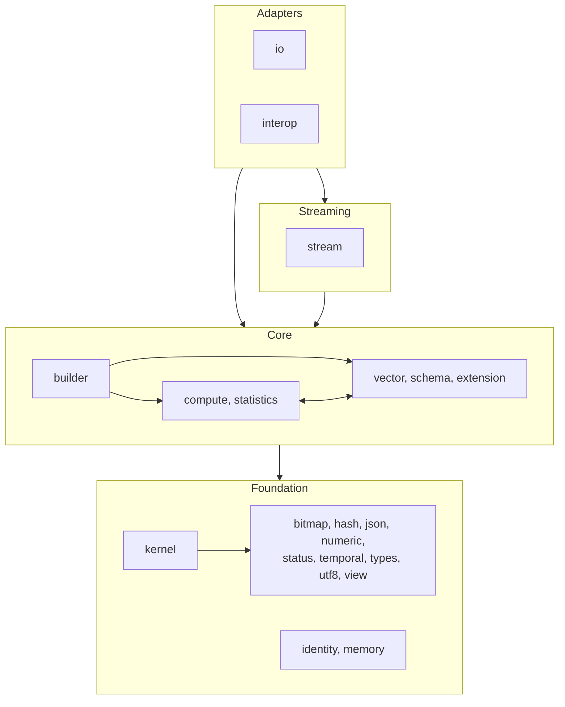
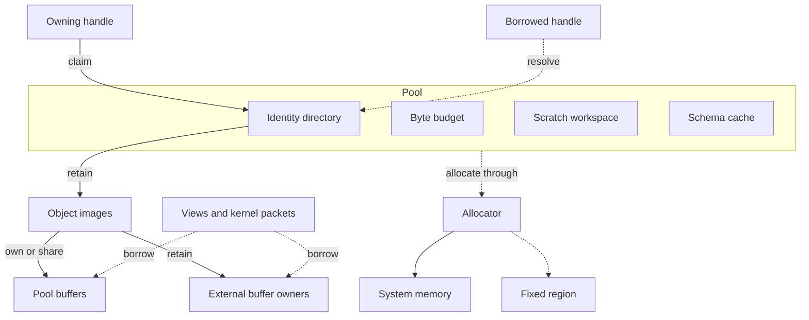
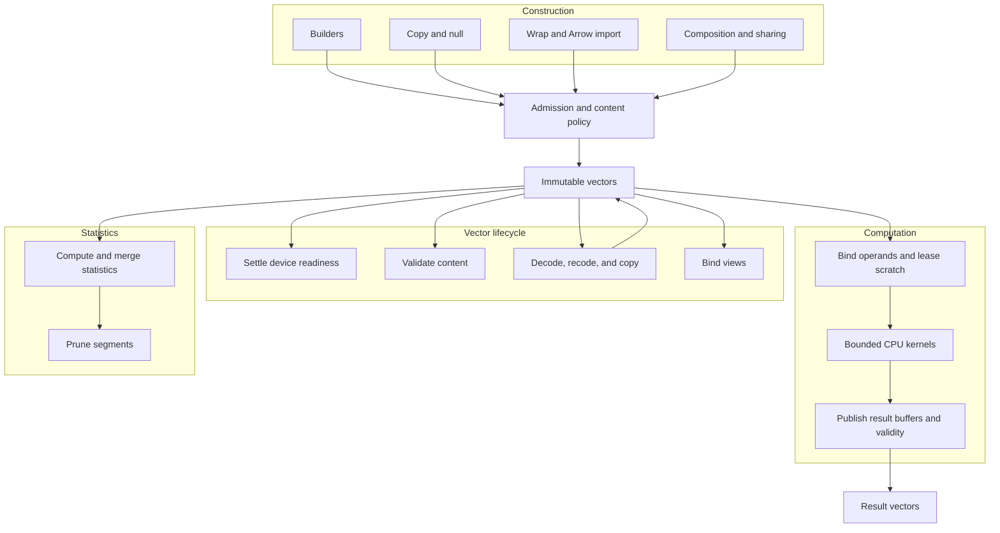
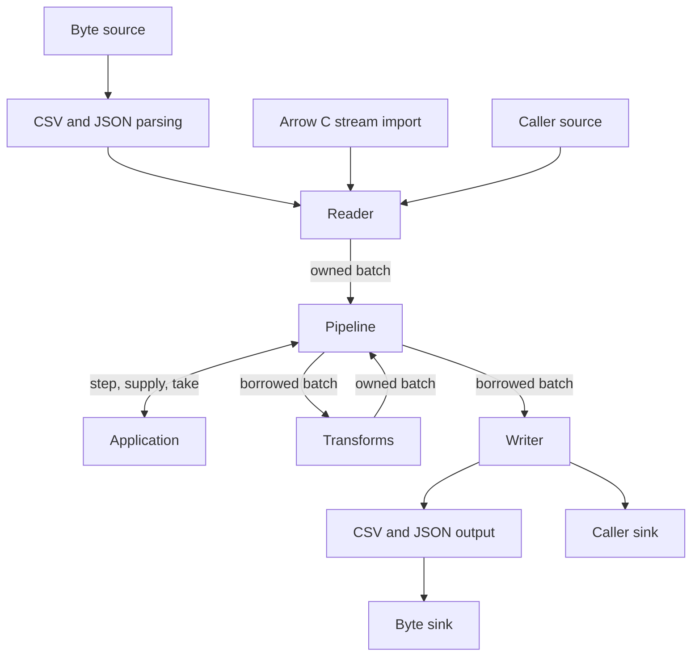
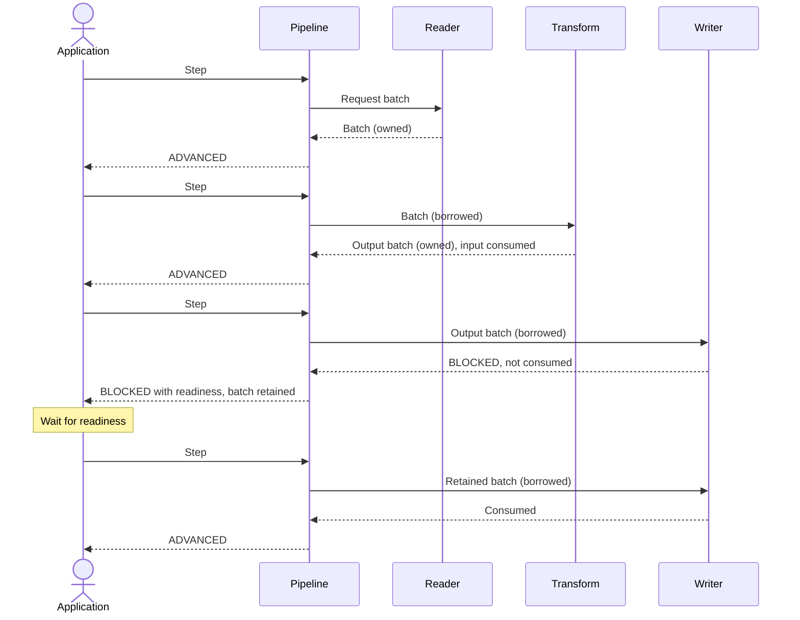
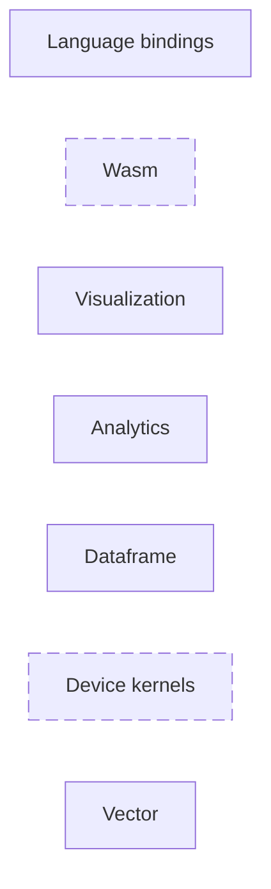
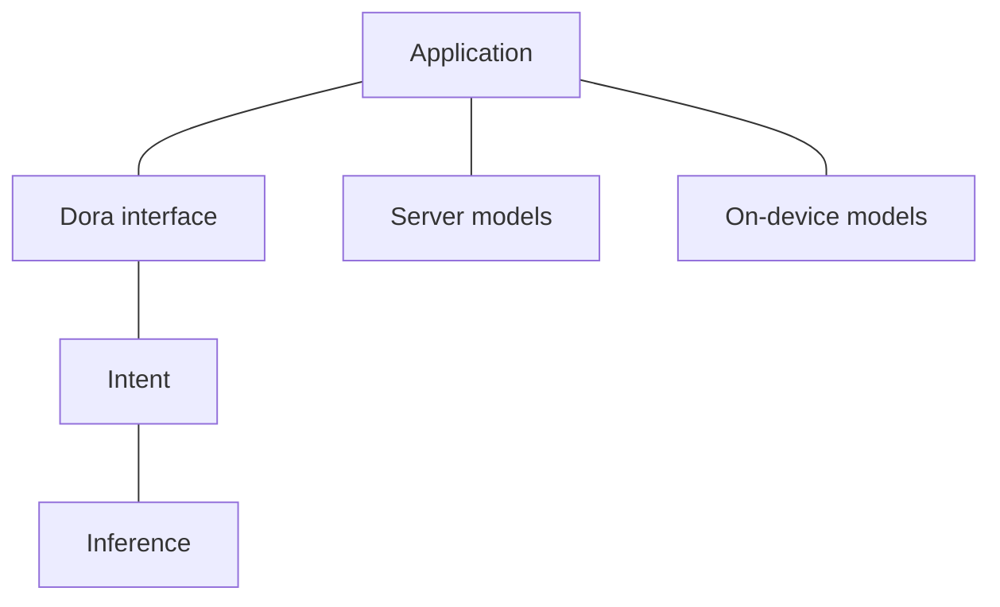

# Architecture

Execution is single-threaded and CPU-only. The caller owns concurrency,
scheduling, and readiness waits. Callbacks run on the calling thread.

## Structure

`include/`: public contracts. `src/`: implementation.

### `include/`

```text
include/
└── dora/
    ├── vector/
    │   ├── bitmap.h
    │   ├── builder.h
    │   ├── compute.h
    │   ├── device.h
    │   ├── extension.h
    │   ├── handle.h
    │   ├── interop/
    │   │   └── arrow/
    │   │       ├── abi.h
    │   │       └── arrow.h
    │   ├── io/
    │   │   ├── byte.h
    │   │   ├── csv.h
    │   │   ├── file.h
    │   │   ├── json.h
    │   │   └── schema_inference.h
    │   ├── memory.h
    │   ├── schema.h
    │   ├── statistics.h
    │   ├── status.h
    │   ├── stream.h
    │   ├── types.h
    │   ├── vector.h
    │   └── view.h
    └── vector.h
```

[`dora/vector.h`](../include/dora/vector.h) includes every public header except
`interop/arrow/`.

### `src/`

| Directory | Responsibility |
| --- | --- |
| [bitmap](../src/bitmap/) | Packed bits. |
| [builder](../src/builder/) | Mutable construction and publication. |
| [compute](../src/compute/) | Whole-vector contracts, allocation, and publication. |
| [extension](../src/extension/) | Registry and storage semantics. |
| [hash](../src/hash/) | Value hashing and row-key membership. |
| [identity](../src/identity/) | Identity entries, generations, and ownership claims. |
| [interop](../src/interop/) | Arrow adapters. |
| [io](../src/io/) | Byte transport, text formats, and inference. |
| [json](../src/json/) | JSON grammar and navigation. |
| [kernel](../src/kernel/) | Bindings and bounded CPU execution. |
| [memory](../src/memory/) | Allocators, pools, accounting, and scratch. |
| [numeric](../src/numeric/) | Arithmetic, decimals, and carriers. |
| [schema](../src/schema/) | Immutable declarations and topology. |
| [statistics](../src/statistics/) | Summaries, bounds, merge, and pruning. |
| [status](../src/status/) | Error records. |
| [stream](../src/stream/) | Readers, writers, and pipeline state. |
| [temporal](../src/temporal/) | Calendar, tick, and interval semantics. |
| [types](../src/types/) | Type/layout facts, loads, and ordering. |
| [utf8](../src/utf8/) | UTF-8 operations. |
| [vector](../src/vector/) | Images, lifetime, admission, and operands. |
| [view](../src/view/) | Borrowed coordinates and validity. |

## Overview



- Only upward dependency: `memory` calls into every module whose objects the
  pool frees.

## Data and ownership

| Element | Contract |
| --- | --- |
| Types | Logical meaning, physical carrier, and storage layout are separate. |
| Schemas | Immutable declarations and preorder topology. |
| Extensions | Per-pool definitions bind logical semantics to storage; validation is optional. |
| Vectors | Immutable flat, nested, or encoded images; own buffers or retain providers and children. |
| Validity | Separate from payload; Struct child views combine parent and own nulls. |
| Handles | Generation-checked identities. Owning handles carry claims; struct assignment does not retain. Schemas and builders add a node index; vectors add a row range. |
| Borrows and views | Require live source ownership; navigation does not retain. |
| Pools | Allocate from system memory, a caller allocator, or a fixed region; charge payload, overhead, and retained capacity to a byte limit. |
| Pool reset | Frees owned objects and caches. Raw allocations, cross-pool claims, or active work return `EBUSY`. |
| Pool release | Returns `EBUSY` while objects, raw allocations, claims, or work remain; invalidates handles. |
| Cross-pool sharing | Pins providers; allocations remain charged to providers. |
| Scratch | Scoped pool leases; published outputs retain no scratch pointers. |
| Admission | Structural checks precede publication; content proof is separate. |
| Builders | Own mutation; publication produces immutable vectors. Shared consumers prevent storage reuse. |



## Construction and computation

| Element | Contract |
| --- | --- |
| Compute | Owns type resolution, failure policy, allocation, and publication. |
| Packets | Fixed-width compute binds encodings and selections into packets of at most 2,048 rows. |
| Kernels | Borrow buffers; allocate no memory, resolve no handles, publish no vectors. |
| Statistics | Vectors; exact bounds support compute proofs. |
| Pruning | Returns `MAY_MATCH` unless statistics prove `CANNOT_MATCH` or `ALL_MATCH`. |



## Streams

| Element | Contract |
| --- | --- |
| Reader (`dora_reader`) | Wraps a `dora_vector_source`; publishes owned batches. |
| Transform (`dora_vector_transform`) | Borrows input; publishes owned output. |
| Writer (`dora_writer`) | Wraps a `dora_vector_sink`; borrows batches; reports consumption. |
| Pipeline (`dora_pipeline`) | Each step advances one stage, most downstream pending batch first. Retains pending batches under backpressure. |
| End of input | Pending batches drain before the writer finishes. |
| No reader or writer | The caller supplies or takes batches. |





### Text transport

- Read: byte source → framing → parser → builder → owned batches.
- Write: borrowed spans → byte sink.
- Schema inference retains sampled bytes for replay on nonseekable sources.
- Retained batch slices pin their backing blocks.

## Interchange

Native storage is independent of Arrow structures.

| Arrow route | Contract |
| --- | --- |
| Copy import | Copies into native storage. |
| Move import | Adopts producer release after successful publication. |
| Wrap import | Borrows foreign storage; the caller preserves its lifetime. |
| Import limits | Bound traversal depth, nodes, edges, and work. |
| Array export | Retains native buffers; allocates descriptors. Selected vectors return `ENOTSUP`; validity is copied when its bit offset differs from the value offset. |
| Schema export | Copies declarations; source lifetime is independent. |
| Stream import and export | Move the source stream or reader into the result. |
| Statistics | Converts a vector's statistics to and from the Arrow statistics schema. |
| Device arrays | Preserve foreign identity and readiness; host copies of device-only buffers use caller callbacks. |

Arrow C streams are blocking pull iterators over same-schema arrays
([semantics](https://arrow.apache.org/docs/format/CStreamInterface.html#semantics));
returned arrays and schemas have independent lifetimes
([result lifetimes](https://arrow.apache.org/docs/format/CStreamInterface.html#result-lifetimes)).

Arrow IPC serialization and Flight transports are absent.

## Dora modules

Vector is the core of the modular Dora ecosystem. Dashed modules are optional.



| Module | Responsibility |
| --- | --- |
| Vector | Columnar data, memory pools, CPU kernels, streams, and Arrow interchange. |
| Device kernels | Optional accelerator kernels and device resources. |
| Dataframe | Tables, expressions, query parsing, planning, optimization, and execution. |
| Analytics | Data semantics, statistical methods, and derived features. |
| Visualization | Renderer-independent visual models over analytical results; applications render them. |
| Wasm | Optional WebAssembly runtime and browser/edge bindings. |
| Language bindings | Host APIs for Vector, Dataframe, Analytics, and Visualization. |

### Model integration


